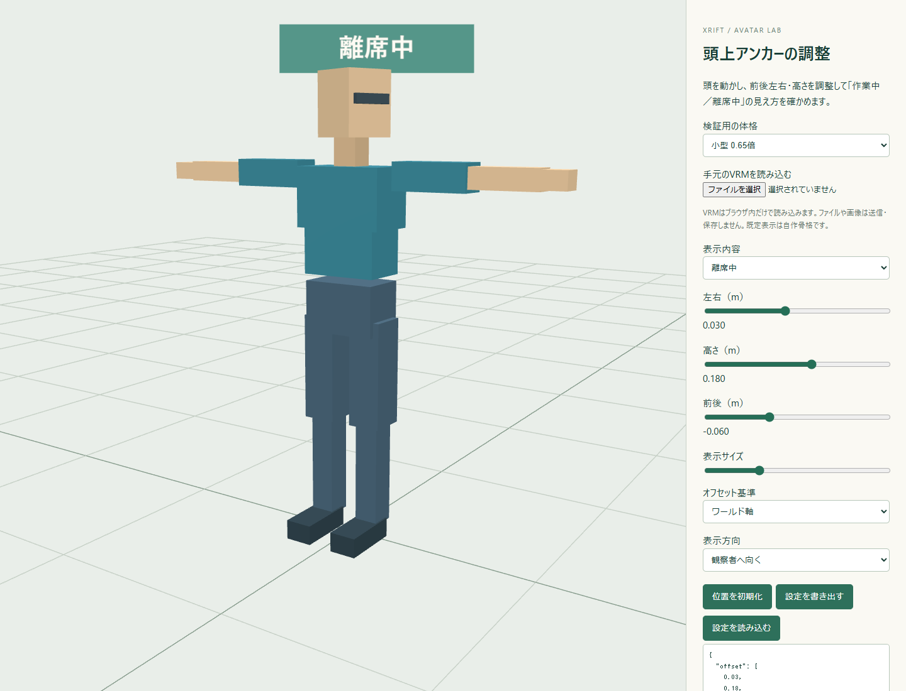

# XRift Avatar Anchor

頭に追従する表示・小物の位置合わせを探る実験用ライブラリです。「作業中／離席中」の頭上表示を最初の題材にしています。

## 最初に動かす

Node.js 22以上で、次を実行します。

```sh
npm ci
npm run dev
```

http://127.0.0.1:5227/ を開きます。自作の標準／小型／大型骨格を選び、左右・高さ・前後と大きさを調整できます。JSONの書き出し・読み込みで補正を再利用できます。実VRMは画面のファイル選択でブラウザ内だけに読み込みます。

モデルのローカル保管には [local-assets/vrm/](local-assets/vrm/README.md) を使えます。このフォルダのREADME以外はGit対象外です。デモのファイル選択から読み込んでください。



## 入っているもの

- Three.jsだけに依存する頭アンカー。頭のObject3Dを明示的に渡せる。
- ワールドのメートル単位／頭ボーンのローカル軸によるオフセット、表示スケール。
- 頭回転へ追従／水平を維持／観察カメラへ向く表示。
- XRiftの所有者マーカーを使う保守的な補助アダプター。複数候補なら適用を保留する。
- 位置ずれ・小型化・親の座標変換・設定の往復・対象の曖昧さのテスト。

## コアの使い方

```js
import { createHeadAnchor } from './src/index.mjs'
const anchor = createHeadAnchor(labelGroup, {
  offset: [0, 0.22, -0.04], offsetSpace: 'world',
  rotationMode: 'world-up', scale: 0.8
})
// フレームごと。アバター本体やカメラは書き換えない。
anchor.update({ head: headBone })
// 取り外し時には表示物の元のローカル姿勢を戻す。
anchor.dispose()
```

頭ボーンは見た目の頭頂・帽子の中心と一致するとは限りません。自動的な頭追従と手動の補正を分けて扱います。頭ローカルの軸はモデルのボーンの軸で、VRM世代間で一律の「前」を保証するものではありません。

## XRiftへつなぐとき

```js
import { selectXRiftHead } from './src/adapters/xrift.mjs'
const result = selectXRiftHead({ scene, userId, localUserId, avatarRoot })
if (result.status === 'ready') anchor.update({ head: result.head })
```

avatarRootが取得できる場合は明示します。SDKのuseUsersだけでVRM本体が得られるとは仮定しません。元アイテムの所有者判定と取り外し処理へ接続し、同じ表示物を二重制御しないでください。

## 現段階

Three.jsのローカルデモです。XRift Marketplaceアイテム、アバター別の自動保存、複数人のステータス同期、自動離席判定は未実装です。非一様拡縮と回転によるshearがある親、Quest、実XRiftの他者視点も未確認です。

検証: `npm run verify`。型宣言の利用例・単体テスト・デモのビルドを確認します。

- [実験指針と準備するVRM](docs/EXPERIMENTS.md)
- [次のスレッドへ渡す文](docs/NEXT_THREAD.md)
- [現状と確認範囲](docs/STATUS.md)
- [来歴・ライセンス](docs/PROVENANCE.md)
