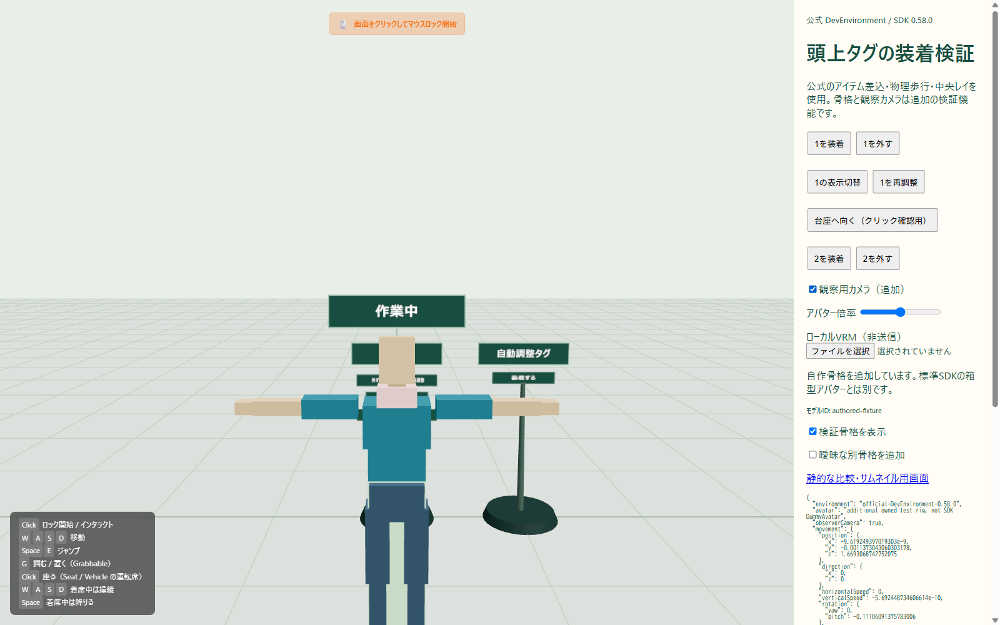
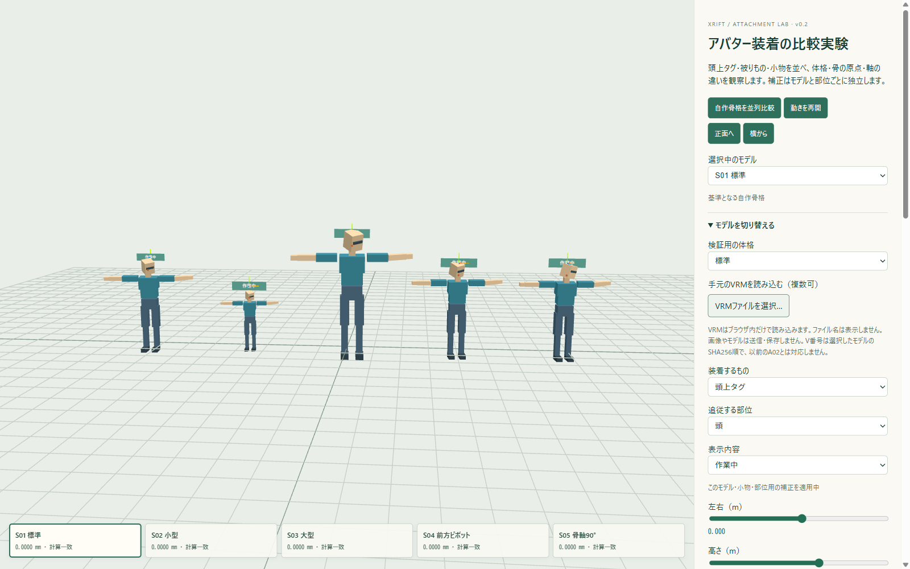

# XRift Avatar Anchor

頭上タグ・被りもの・胸バッジ・手の小物のための、部位追従とモデル別補正の実験ライブラリです。**追従計算と、見た目の装着位置合わせを分ける**基礎規格v1を用意しました。XRift公式規格ではありません。

## 配布用の自動調整タグ

[item/overhead-tag](item/overhead-tag/README.md) に実アイテムを実装しました。[XRiftアイテム](https://app.xrift.net/marketplace/82fe0855-60d8-4880-9f88-f3c10276796c) はv2・ACTIVEです。装着時に頭へ影響するスキン頂点から位置を推定し、タグを追従させます。解除、表示切替、再調整、上下補正に対応します。

```sh
npm ci --prefix item/overhead-tag
npm run item:dev
```

[公式ローカルSDKを使う検証画面](http://127.0.0.1:5237/) では、公式DevEnvironment 0.58.0へのアイテム差込・物理歩行・中央レイを使用します。骨格/ローカルVRMと観察カメラは追加の検証機能です。装着→歩行追従→解除、2配置の分離、取得不能/曖昧時の保留、3体の実VRMを確認しました。



## 動かして比較する

Node.js 22以上で実行します。

```sh
npm ci
npm run dev
```

[ローカル比較画面](http://127.0.0.1:5227/) は、自作5条件を同時に動かします。標準・小型・大型・前方へずれた頭ピボット・90度違う骨軸を並べ、タグ／帽子／小物と、頭／胸／左手を切り替えられます。カードを選ぶと、そのモデルだけの補正を調整できます。



「手元のVRMを読み込む」では複数の実VRMをブラウザ内だけで比較できます。V番号はSHA256順の表示名で、補正の保存にはモデルのハッシュを含むIDを使います。実ファイル名は表示・書出ししません。ローカル保管先は [local-assets/vrm/](local-assets/vrm/README.md) で、README以外はGit対象外です。

補正はモデル・小物・部位ごとに独立します。`モデル別プロファイル v1` からJSONを保存・読込でき、対象不一致を拒否します。ページを閉じるとメモリ内の補正は消えます。旧形式の設定JSONを明示的に移す操作も残しています。

帽子が埋もれる場合は「中立姿勢の上向きに合わせる」で参考補正を作り、その後に位置とサイズを手直しします。モデル全体の上端を使う推定で、頭頂への正確な装着合格ではありません。

## 規格と使い方

**[基礎規格v1](docs/ANCHOR-SPEC-v1.md)** に座標系、支点、回転、倍率、モデル識別、プロファイル、フレーム順、解除、保留条件をまとめています。

```js
import {createAnchor} from './src/index.mjs'
import {selectVRMBone} from './src/adapters/vrm.mjs'

const anchor = createAnchor(hatGroup, {
  offset: [0, 0.2, 0], offsetSpace: 'bone',
  rotationMode: 'bone', scale: 1
})
// アニメーション・IK・VRM更新の後、描画前に呼ぶ。
const result = selectVRMBone({vrm, bone: 'head', space: 'raw'})
hatGroup.visible = false
if (result.status === 'ready') {
  anchor.update({bone: result.bone})
  hatGroup.visible = true
}
// 解除時。可視性・資源破棄は呼出側で管理する。
anchor.dispose()
```

上の補正は説明用です。骨原点は頭頂と異なり、骨ローカルの「上」「前」もモデル次第です。帽子にはモデル別の位置・回転・大きさの校正が必要です。`createHeadAnchor` / `updateHeadAnchor` の既存APIも使えます。

XRiftでは [所有者アダプター](src/adapters/xrift.mjs) へ、ホストが所有者と対応付けたavatarRootと意味付きbone mapを渡します。`useUsers` からVRM本体を得られるとは仮定しません。頭以外を骨名だけで推測せず、取得不能や曖昧な対象は保留します。

## 再実験と証拠

```sh
npm run verify
npm run experiment
node scripts/run-experiments.mjs --local-vrm
```

`verify` は単体テスト・型検査・デモビルド。`experiment` は自作6条件の810計測、`--local-vrm` はローカル3モデルのGLB骨格データ405計測も加えます。これはメッシュを読み込むブラウザ検証とは別です。

再実験は毎回新しい `artifacts/experiments/<時刻とID>/` へ結果を残し、保存済みの基準記録を上書きしません。

- [規格v1](docs/ANCHOR-SPEC-v1.md)
- [実験結果と残る確認](docs/STATUS.md)
- [1,215条件の数値マトリクス](docs/experiments/MATRIX-2026-10-25.md)
- [実VRMの観察と補正前後](docs/experiments/VISUAL-LOOP-2026-10-25.md)
- [実験手順](docs/EXPERIMENTS.md) / [ブラウザ確認](scripts/README.md)
- [引き継ぎ](docs/NEXT_THREAD.md) / [来歴と配布範囲](docs/PROVENANCE.md)

Quest、他者視点、実複数人、実VRM1系は未確認。タグの装着者/表示/高さは配置IDごとに共有状態を持ちますが、複数人の受入検証・アバター別永続保存・自動離席判定は未実施です。実XRiftの受入範囲は [STATUS](docs/STATUS.md) を参照してください。元のhead-propeller-rideや既存公開アイテムは変更していません。コードのライセンスはUNLICENSED、npm公開は無効です。
